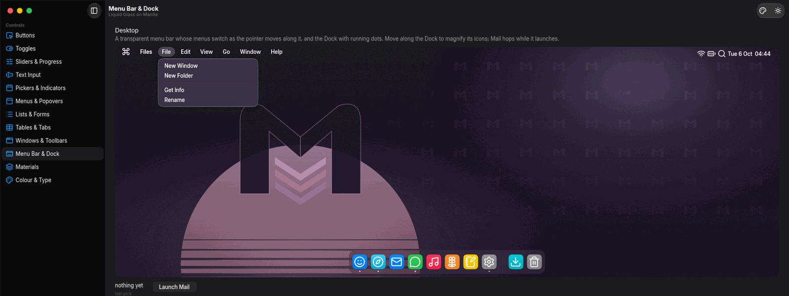
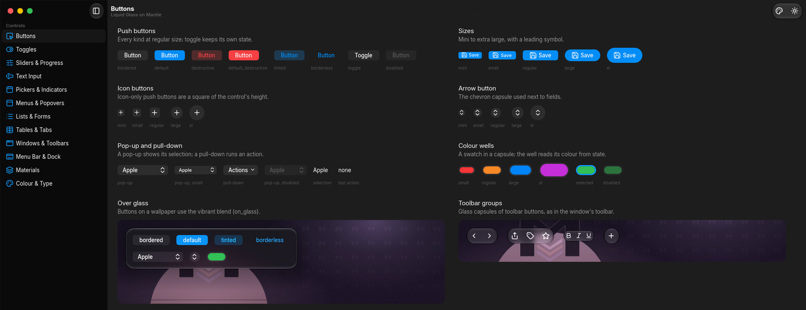

# mantle-glass





A Liquid Glass component library for the [Mantle](https://github.com/anasgets111/mantle)
shell engine, with a demo app that shows every component.

- 50+ components: window chrome (traffic lights, toolbars, sidebar, inspector, tabs), buttons,
  toggles, sliders, text fields and text views, pickers, tables and outlines, menus, popovers,
  alerts, sheets, tooltips, notifications, a menu bar and a Dock.
- Liquid Glass materials with refraction, vibrancy, light and dark, any accent colour, and the
  inactive-window look.
- Follows the desktop's dark mode, accent, contrast and reduced-motion settings.
- Every `opts` table is typed for LuaLS, so the editor completes and checks them.

## Use it

Copy or symlink `glass/` into your Mantle config directory, then:

```lua
fonts { "Inter", "lucide", "Noto Sans" }
local glass = require("glass")
glass.core.window = "app" -- the app window's id, before building controls

return {
    glass.app_window {
        id = "app",
        title = "My app",
        child = glass.button("save", { label = "Save", kind = "default" }),
    },
}
```

Requirements, conventions and the full API are in [`glass/README.md`](glass/README.md).

## Run the demo

```sh
mantle -c .
```

The demo's wallpapers are in `demo/wallpapers/`, from the Mantle repo's own demo.

## Layout

| Path | Holds |
| :--- | :--- |
| `glass/` | The library: base layer (`theme`, `core`, `material`, `overlay`) and `chrome/`, `controls/`, `inputs/`, `views/`, `overlays/` |
| `demo/`, `shell.lua` | The demo app, one page per component family |
| `justfile` | `just`: syntax, LuaLS types and `mantle check` |

## Editor setup

`.luarc.json` gives lua-language-server the engine's API stubs, so the editor completes and
type-checks Mantle and the library. Its `workspace.library` points at a Mantle checkout's
`lua-meta/`; change it to wherever your stubs are:

| Mantle from | Stubs |
| :--- | :--- |
| A package | `$PREFIX/share/mantle/lua-meta` (usually `/usr/share/mantle/lua-meta`) |
| A plain binary | `$XDG_DATA_HOME/mantle/lua-meta` (usually `~/.local/share/mantle/lua-meta`), written by `mantle init` |
| A source checkout | `<checkout>/lua-meta` |

`just types` runs the same check from the command line.

## Notes

Not affiliated with or endorsed by Apple. Liquid Glass is a trademark of Apple Inc. The
library ships no Apple fonts, symbols or artwork: Inter and Lucide stand in for SF Pro and SF Symbols.

## License

[MIT](LICENSE).
